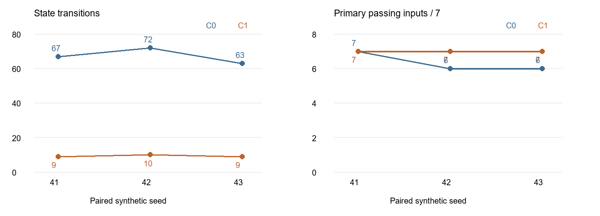
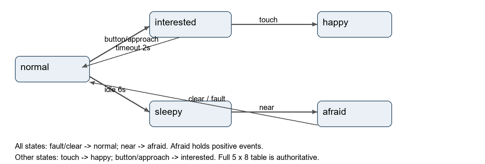

# ใบงาน Lab06 ฉบับตอบพร้อมผลทดลอง

อิทธิพล แป้นอ้อย / 6752500053 | กลุ่ม: ยังไม่ระบุ | วันที่รัน 09/11/2026

ผลทั้งหมดเป็น simulation ด้วย virtual clock และ proposed course model ไม่มี learning และยังไม่ได้วัด ROS/DDS หรือการเคลื่อนไหวของหุ่นยนต์จริง

## 1 Prediction และ protocol
บันทึก prediction ก่อนรันใน results/completed_20261109/PREDICTION_BEFORE_RUN.json โดยผู้ช่วยเตรียมก่อน execute: C0 อาจสลับ state จาก bounce/noise บ่อยกว่า C1; C1 debounce/hysteresis เพิ่มเวลารอการยืนยัน แต่ลดคำสั่งที่ถูกแทรกก่อน apply สมมติฐานไม่ได้รับรองว่า latency สูงสุดของ C1 ต้องมากกว่า C0 เพราะ C0 อาจถูก preempt หลายครั้ง near ต้องมี priority เหนือ touch; fault ขณะ normal และ touch ระหว่าง afraid อาจไม่มี onset ใหม่

ใช้ baseline mapping เดียวกัน C0 raw และ C1 guarded, seeds 41/42/43 แบบจับคู่, dt=0.02 s, duration=22 s, scheduler=0.04 s; C1 debounce button/touch=0.06 s, near enter≤0.20/exit≥0.28 m, approach enter≤0.80/exit≥0.95 m; sample age>0.12 s หรือ invalid → fault คง bounds และ slew ทั้งสองเงื่อนไข Deadline=1 s; observation window=22 s เป็นสาม synthetic replications ไม่ใช่ผู้เล่นสามคน

Expected IDs ประกาศก่อนรัน 7 รายการ: button_01, touch_01, approach_01, clear_01, near_01, clear_02, button_02 คงทั้ง 10 sources ใน metrics โดยอีก 3 รายการคือ touch_conflict, invalid_01 และ stale_01 ไม่บังคับให้สร้าง expression ใหม่

## 2 FSM และ guard
ทุก state: fault→normal; near→afraid; clear→normal. เมื่อ afraid ให้ hold positive events และ timeout/idle จนได้รับ clear หรือ fault. State อื่น: touch→happy; button/approach→interested; interested/happy + timeout 2 s→normal; normal + idle 6 s→sleepy; อื่น ๆ hold

Priority: fault > near > clear > touch > button > approach > timeout > idle. Entry afraid เกิดจาก near; exit ต้อง clear/fault จึงไม่ถูก touch ดึงออกจากสถานะหลบอันตราย

| state | fault | near | clear | touch | button | approach | timeout | idle |
|---|---|---|---|---|---|---|---|---|
| normal | normal | afraid | normal | happy | interested | interested | hold | sleepy |
| interested | normal | afraid | normal | happy | interested | interested | normal | hold |
| happy | normal | afraid | normal | happy | interested | interested | normal | hold |
| afraid | normal | afraid | normal | hold | hold | hold | hold | hold |
| sleepy | normal | afraid | normal | happy | interested | interested | hold | hold |

## 3 Expression mapping และความปลอดภัย
q=[tilt,extend,nod] หน่วย rad เป็นแกนนามธรรม ไม่ใช่พิกัดข้อต่อจริงโดยอัตโนมัติ

| State | q target rad | RGB 0–255 | ความหมาย |
|---|---|---|---|
| normal | [0,0,0] | [60,90,140] | กลับท่ากลาง |
| interested | [0.22,0.18,0.06] | [255,180,0] | เอียงและยืดเข้าหา |
| happy | [0.10,0.10,0.18 sin(2π elapsed)] | [40,220,80] | พยักหน้า |
| afraid | [-0.22,-0.22,-0.16] | [230,30,30] | หดและก้มหลบ |
| sleepy | [0,-0.15,-0.20] | [50,40,100] | หดและก้มพัก |

Bounds tilt±0.35, extend±0.25, nod±0.30 rad; slew≤0.8 rad/s จาก course model ค่าพวกนี้ไม่ใช่ actuator limits ที่รับรองแล้ว ก่อนต่อจริงต้องวัด neutral/ทิศหมุน/หน่วย/อัตราทด/พื้นที่ชน/ขีดจำกัดแต่ละแกน, clamp+slew ใน driver, watchdog และ E-stop แยกจาก FSM. fault→normal อาจยังสั่งเคลื่อนกลับกลาง จึงไม่เท่ากับ emergency stop. ผู้ทดสอบเป็นผู้ควบคุมหยุด; ยังไม่มีผล calibration จริง

## 4 Checker และการแก้
Starter ตรวจ 40 transition pairs ไม่ผ่าน 7 กรณี ตัวอย่าง interested+timeout คืน None จึงไม่กลับ normal แก้โดยคืน normal เมื่อ current_state เป็น interested/happy และ event=timeout เพิ่ม normal+idle→sleepy และ touch→happy หลัง afraid guard ผล checker_baseline.txt และ checker_group.txt ผ่านทั้ง 40 คู่ ไม่ได้ปิด safety หรือเปลี่ยน engine

## 5 ผล C0/C1
| Condition/seed | All sources | Both | ≤1s both | No both | Max observed s | State transitions |
|---|---|---|---|---|---|---|
| C0/41 | 10 | 7 | 7 | 3 | 0.24 | 67 |
| C1/41 | 10 | 7 | 7 | 3 | 0.14 | 9 |
| C0/42 | 10 | 6 | 6 | 4 | 0.18 | 72 |
| C1/42 | 10 | 7 | 7 | 3 | 0.14 | 10 |
| C0/43 | 10 | 6 | 6 | 4 | 0.04 | 63 |
| C1/43 | 10 | 7 | 7 | 3 | 0.14 | 9 |



รวม primary 21 input opportunities ต่อ condition: C0 ผ่าน 19/21 ขาด 2; C1 ผ่าน 21/21 ขาด 0. All sources=30 ต่อ condition; both C0=19/30, C1=21/30. C1 ลด transitions จาก 67/72/63 เป็น 9/10/9 ลดลง 58/62/54 ครั้งหรือ 86.57/86.11/85.71% ตามลำดับ ทั้งสองไม่มี command clamp แต่ไม่ได้แปลว่า hardware ปลอดภัยแล้ว

Negative results: C0 seed42 clear_01 ไม่ถูก recognize; seed43 clear_02 เป็น no_state_change จึงไม่มี both onset ไม่ใส่ latency=0. Latency สูงสุดที่สังเกต C0=0.24/0.18/0.04 s, C1=0.14/0.14/0.14 s จึงไม่มีหลักฐานว่า C1 ช้ากว่าเสมอ. C1 button_01 seed41 ช้ากว่า C0 0.10 s (0.14−0.04), แต่ approach C1=0.04 s เร็วกว่า C0=0.24 s เพราะ candidate ของ C0 ถูก preempt

## 6 ตรวจ latency จาก CSV
เลือก C1 seed41 จาก comparison/events_C1_r01.csv

| Input | Source | Recognized | Decision/queue | Apply | Motion | RGB | Both latency s |
|---|---|---|---|---|---|---|---|
| button_01 | 1.0 | 1.1 | 1.1 | 1.14 | 1.14 | 1.14 | 0.14 |
| touch_01 | 3.0 | 3.06 | 3.06 | 3.1 | 3.1 | 3.1 | 0.1 |

button: filter=1.10−1.00=0.10 s; decision=recognition; queue→actual apply=1.14−1.10=0.04 s; both=max(1.14,1.14)−1.00=0.14 s. Debounce ตั้งไว้ 0.06 s แต่ bounce ทำให้รอจนค่านิ่งจึงใช้จริง 0.10 s. touch: 3.10−3.00=0.10 s โดย recognition3.06, apply3.10. งบออกแบบก่อน hardware: sensor/transport≤0.20, filter/decision≤0.20, queue/physical output≤0.40 รวม≤0.80 s เผื่อ0.20 s; เป็นเป้าหมาย ไม่ใช่ผลวัดจริง

## 7 Conflict fault sleep recovery และ missing
C1 seed41 near7.00→afraid, touch recognize7.06 ถูก policy_held เพราะ afraid guard; C0 ที่ recognize พร้อมกันอาจ discarded_priority. clear9.00→normal; invalid11.00 และ stale12.00 รับ fault แต่ state เดิม normal จึง no_state_change; idle15.00→sleepy; button18.00 recognize18.06→interested และ output18.10; timeout20.06→normal, apply20.10

discarded_priority คือแพ้ event อื่นใน tick เดียว; policy_held คือ policy คืน None; no_state_change คือ target เท่า state เดิม; preempted_before_apply คือคำสั่งถูกแทนก่อน output; censored_end คือจบ trial ก่อนเห็น onset. กรณีไม่เห็นทั้งสองช่องเก็บ null/N/A พร้อมเหตุผล ไม่สรุปว่าทุก missing เป็น drop และไม่แทนด้วย0. เก็บรายการทั้งหมดดังนี้

| Condition/seed | Input ID | Status |
|---|---|---|
| C0/41 | touch_conflict | discarded_priority |
| C0/41 | invalid_01 | no_state_change |
| C0/41 | stale_01 | no_state_change |
| C1/41 | touch_conflict | policy_held |
| C1/41 | invalid_01 | no_state_change |
| C1/41 | stale_01 | no_state_change |
| C0/42 | clear_01 | filtered_not_recognized |
| C0/42 | touch_conflict | preempted_before_apply |
| C0/42 | invalid_01 | no_state_change |
| C0/42 | stale_01 | no_state_change |
| C1/42 | touch_conflict | policy_held |
| C1/42 | invalid_01 | no_state_change |
| C1/42 | stale_01 | no_state_change |
| C0/43 | touch_conflict | discarded_priority |
| C0/43 | clear_02 | no_state_change |
| C0/43 | invalid_01 | no_state_change |
| C0/43 | stale_01 | no_state_change |
| C1/43 | touch_conflict | policy_held |
| C1/43 | invalid_01 | no_state_change |
| C1/43 | stale_01 | no_state_change |

## 8 Replay และไฟล์หลักฐาน
raw_C1_r01.csv และ events_C1_r01.csv ของ replay ตรงต้นฉบับ byte-for-byte และ SHA256; รายละเอียด analysis_validation.json. seed ใน replay config อาจเป็น null เพราะอ่าน fixture โดยตรง ไม่ใช่สุ่มใหม่. policy SHA256=0be3de88fc5d99008982aa7ba0e93121e8c37ad1f1fcbd37e6b6d7f9def6379b

ไฟล์อยู่ results/completed_20261109/comparison/: config.json, inputs_r01–03.csv, source_inputs_r01–03.csv, raw_C0/C1_r01–03.csv, events_C0/C1_r01–03.csv, metrics.json/csv, manifest.json, source_snapshot/, report.html และ trace SVG. Python version และคำสั่งจริงอยู่ RUN_MANIFEST.json. ใช้ output ใหม่เสมอเพื่อไม่เขียนทับ raw

```powershell
python check_submission.py --contract baseline
python check_submission.py --contract group
python lab06.py --policy student --condition all --repeats 3 --output-dir results/reproduce_01
python lab06.py --policy student --condition C1 --repeats 1 --replay results/completed_20261109/comparison/inputs_r01.csv --output-dir results/replay_reproduce_01
```

## 9 สรุปและ exit quiz
FSM ทำให้ตรวจได้ครบ40คู่และตรวจ priority/guard อย่างชัดเจน การคืน None ต่างจากคืน state เดิม. C1 สนับสนุน prediction ว่าลด chattering แต่ latency ต้องดูทั้ง misses และ candidate preemption ไม่อ้างจากค่ากลางเพียงอย่างเดียว กราฟและตัวเลขไม่พิสูจน์ physical responsiveness

Learning ต้องมี policy/parameter เปลี่ยนจากประสบการณ์ เช่นเรียนรู้ preference gain จาก feedbackพร้อม validation; FSM คงที่นี้ยังไม่เรียนรู้ งานต่อยอด sound/phone interaction แยกจาก mandatory lab. ก่อนยืนยัน real latency ต้องวัดต้นทางปุ่ม/สัมผัสด้วย triggerร่วมกับ encoder/กล้องสำหรับ motion และ photodiode สำหรับ RGB พร้อมระบุ clock mapping และ uncertainty

อ้างอิงภายใน: README.md, interface_contract.json, course_model.py และข้อมูลดิบ/metrics ของ run นี้ ค่าตัวเลข mapping/filter เป็น proposed course model ไม่ใช่ผลสอบเทียบจากหุ่นยนต์



