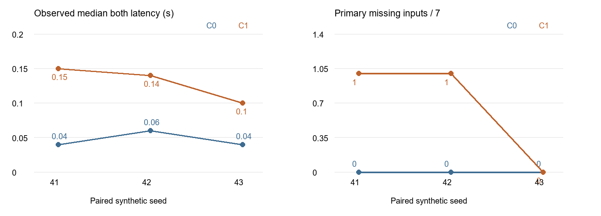
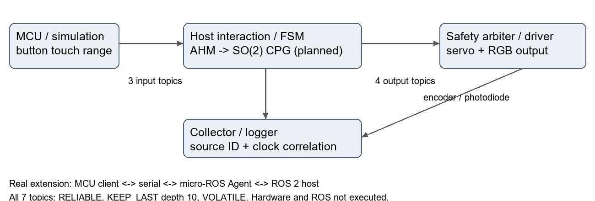

# ใบงาน Lab07 ฉบับตอบพร้อมผล offline

อิทธิพล แป้นอ้อย / 6752500053 | กลุ่ม: ยังไม่ระบุ | วันที่รัน 09/11/2026

ผลทั้งหมดเป็น simulation ด้วย virtual clock และ proposed course model ไม่มี learning และยังไม่ได้วัด ROS/DDS หรือการเคลื่อนไหวของหุ่นยนต์จริง AHM–CPG และ scenarioคน600s ด้านล่างเป็น proposal ยังไม่ได้ implement/run ใน runner FSM นี้

Policy SHA256: 0be3de88fc5d99008982aa7ba0e93121e8c37ad1f1fcbd37e6b6d7f9def6379b

## 1 Architecture และ topic contract
ระบบ offline: synthetic input_source→validated/debounced interaction/FSM→servo/RGB commands→collector ในprocessเดียว ไม่มีDDS. ROS sourceที่มีอยู่แยกสามexecutable; driver/MCU firmware/Agentต้องเตรียมเพิ่ม

Graph โครงงานที่เสนอ: sensor driver→interaction→AHM(H)→SO(2)CPG(o1,o2)→output arbiter←FSM(state), จากนั้น clamp/slew/watchdog→motor/LED driver→encoder/photodiode logger. ให้ AHM/CPG/arbiter เป็น internalmodulesของinteractionก่อนเพื่อคง7topics; hostเก็บFSM,H,o; MCUเก็บacquisition sequenceและdriver watchdog. อิทธิพลรับผิดชอบcode/analysis; ผู้ควบคุมhardwareและผู้ตรวจsafetyต้องยืนยันก่อนทดลอง

| Topic | Type | Units | Publisher→subscriber |
|---|---|---|---|
| /lamp/input/button | std_msgs/Bool | bool | input_source→interaction |
| /lamp/input/touch | std_msgs/Bool | bool | input_source→interaction |
| /lamp/input/distance | std_msgs/Float32 | m | input_source→interaction |
| /lamp/interaction | std_msgs/String | event | interaction→collector/logger |
| /lamp/emotion | std_msgs/String | state | interaction→collector/logger |
| /lamp/servo_command | std_msgs/Float32MultiArray | rad [tilt,extend,nod] | interaction→collector/driver |
| /lamp/rgb_command | std_msgs/ColorRGBA | r,g,b,a in [0,1] | interaction→collector/LED driver |

QoS ทุกpublisher/subscriber: RELIABLE, KEEP_LAST depth10, VOLATILE ตามinterface_contract.json ทั้งหมดมีqueueจำกัดและต้องตรวจ stale แยก; reliable ไม่รับรองdeadlineหรือphysicalonset. ใช้ ros2 topic list -t, ros2 topic info -v และ ros2 topic echo ตรวจtype/QoS/namespaceเมื่อไม่เห็นmessage. เปลี่ยนเฉพาะsourceและdriver adapterเมื่อย้ายsimulation→robot

## 2 Units และ calibration
servo data=[tilt,extend,nod]rad เช่น interested=[.22,.18,.06]. RGB interested=[255,180,0]→ColorRGBA(1,0.705882,0,1); normal=[60/255,90/255,140/255,1]. เปลี่ยนจำนวนแกนหรือส่งdegreeตรง ๆ ไม่ได้ ต้องแปลงradเป็นjointจริงหลังcalibrate neutral,sign,gearing,linkage/bounds/velocity. J1ฐานตรึงneutralก่อน; mapping J2/J3/J4เป็นเพียงแผนรอตรวจกลไกจริง

Events=fault,near,clear,touch,button,approach,timeout,idle; states=normal,interested,happy,afraid,sleepy. safety priorityและafraid guardเหมือนLab06. Controllerdt=.02s/scheduler=.04s, freshness>.12s→fault. Driverwatchdog/MCUdeadlineต้องกำหนดจากhardwaretestก่อนenable; ไม่ถือ.12sเป็นmotorwatchdogที่สอบเทียบแล้ว

## 3 Hypothesis และ measurement boundary ก่อนรัน
PREDICTION_BEFORE_RUN.json ประกาศว่าC1composite delay/dropอาจเพิ่มage,latency,missingและfault เทียบC0ideal. Controls: FSM,guardedfilter,bounds/slew,22s,dt.02s,scheduler.04sและsourcefixturepairedseeds41/42/43เหมือนกัน. Expected7 IDs=button_01, touch_01, approach_01, clear_01, near_01, clear_02, button_02, retainall10sources; deadline1s, observation22s. Clockเป็นvirtualเดียวกัน; onsetคือappliedcommand ไม่ใช่motor/LEDจริง

C0delay0/drop0; C1delaychoices[0,.02,.04,.06,.10,.14,.18]s,randomdrop.08และburst12.50–12.70s. initialcheckerfail7pairs ตัวอย่าง interested+timeoutคืนNone แก้เช่นLab06 แล้วbaseline/groupผ่าน40pairsทั้งคู่

## 4 ผล3pairedrepeats และ denominator
| Pair/seed | C0 median s | C1 median s | C0 faults/1101 | C1 faults/1101 | Primary missing C0/C1 |
|---|---|---|---|---|---|
| 1/41 | 0.04 | 0.15 | 20 | 54 | 0/1 |
| 2/42 | 0.06 | 0.14 | 20 | 81 | 0/1 |
| 3/43 | 0.04 | 0.1 | 20 | 56 | 0/0 |



Medianคำนวณเฉพาะprimaryที่พบboth จึงต้องอ่านคู่กับmissing: C0ผ่าน21/21; C1ผ่าน19/21 และmissing2 ไม่ใช่latency0. seed41clear_02ไม่มีboth; seed42button_02ไม่มีboth; seed43ครบ7. maxobservedC0=.14sทุกseed, C1=.20/.22/.18s. C1faultticks=54/81/56 เทียบC0=20/20/20 ต่อ1101ticks. การเพิ่มfaultไม่ใช่หลักฐานแยกสาเหตุdropเพียงอย่างเดียว

| C/seed | Published | Received | Accepted | Drop | Out-of-order | Censored | Mean age s |
|---|---|---|---|---|---|---|---|
| C0/41 | 3303 | 3303 | 3303 | 0 | 0 | 0 | 0.000000 |
| C1/41 | 3303 | 3031 | 1618 | 257 | 1413 | 15 | 0.076853 |
| C0/42 | 3303 | 3303 | 3303 | 0 | 0 | 0 | 0.000000 |
| C1/42 | 3303 | 3007 | 1586 | 287 | 1421 | 9 | 0.077931 |
| C0/43 | 3303 | 3303 | 3303 | 0 | 0 | 0 | 0.000000 |
| C1/43 | 3303 | 2991 | 1598 | 300 | 1393 | 12 | 0.076489 |

3303published=3channels×1101ticks/trial. ตรวจ published=received+drop+censored และ received=accepted+out_of_order ทุกtrial. Censoredคือdeliveryหลังจบ22sไม่ใช่drop. Meanageใช้receivedmessagesรวมที่out_of_orderตามrunner. C0mean/maxage=0; C1mean=.076853/.077931/.076489s,max=.18s. ไม่อ้างเป็นROSnetworkbenchmark

ไฟล์repository-relative: results/completed_20261109/comparison/C0_r01..03 และC1_r01..03/ มีinput_trace.csv,command_trace.csv,events.csv,metrics.json,config.json; comparison/summary.json,manifest.json,source_snapshot/,report.html. RUN_MANIFEST.jsonเก็บPython/command/policySHA. ReplayC1seed42: command_trace.csvและevents.csvตรงต้นฉบับbyte-for-byteและSHA; analysis_validation.jsonเก็บผลตรวจ. คำสั่งรันซ้ำใช้outputใหม่

```powershell
python check_submission.py --contract baseline
python check_submission.py --contract group
python offline_lab.py --condition all --repeats 3 --output-dir results/reproduce_01
python offline_lab.py --condition C1 --repeats 1 --replay results/completed_20261109/comparison/C1_r02/input_trace.csv --output-dir results/replay_reproduce_01
python check_proposal.py proposal.json
```

## 5 Invalid/stale กับ communication stress
ทั้งสองconditionมีinvalid11sและstale12sเป็นbaselineprobes จึงC0ยังfault20ticksได้. C1เพิ่มjitter+dropพร้อมกันและทิ้งmessageเก่าตามsequenceในsidecar ทำให้age/missingเปลี่ยน. จะระบุผลjitterหรือdropแยกต้องเพิ่มdelay-only/drop-onlyโดยคงส่วนอื่นเหมือนกัน ห้ามเทียบC1กับC0แล้วสรุปสาเหตุเดี่ยว

## 6 Clock และ micro ROS
MCUclient(sensoracquisition/driver watchdog)→serialtransport→microROSAgent→hostinteraction→commandtopic→Agent→MCUdriver. ยังไม่ได้ต่อหรือรันAgent/firmware. Bool/String/Float32ไม่มีHeaderจึงไม่มีsourceacquisitiontime/IDบนwire; callback receiptสดอาจเป็นค่าเก่าซ้ำ. local_sequenceของคนละnodeไม่ใช่globalID และ perf_counterคนละhostหักตรง ๆ ไม่ได้

แผน: sidecartrial_id/source_id/sequenceจากจุดกำเนิด, hardwaretriggerร่วมกับencoder/photodiodeบนclockเดียวกัน หรือclockmappingoffset/driftที่วัดก่อน/หลังtrialพร้อมresidual+resolutionuncertainty. identityไม่ชัดหรือclockmappingไม่มีให้source_latency=N/A. ROSbagช่วยreplayและตรวจdelivery/config แต่ไม่พิสูจน์physicalonset; collectorreceiptไม่เท่ากับdriverapplyหรือmotion

## 7 Proposal และ exit quiz
proposal.jsonกรอกครบ, ฉบับอ่าน2–3หน้าอยู่results/completed_20261109/proposal.html และproposal.md. มีengagementAHM1ตัว,SO(2)CPG,AHM→CPGgain,baseline2conditions,metrics≥2,simulationและrealconditionละ3repeats,scenario600s,safety/calibration/clock/timeline. เป็นแผนอนาคตทั้งหมด แยกจากผลoffline22s. เช็กproposalยืนยันเพียงfieldครบไม่ใช่อนุมัติความถูกต้องวิทยาศาสตร์/การทดลองมนุษย์

Interfaceช่วยเปลี่ยนadapterโดยคงtype/หน่วย/ความหมาย. Baselineยุติธรรมต้องคงpolicy,fixture,reset,CPG,limits,transport,measurementเหมือนกัน เปลี่ยนเพียงhormonememoryในproject; เก็บทุกmissing/abortพร้อมเหตุผล. อ้างอิงภายใน: README.md,interface_contract.json,lamp_week07/course_model.py,Lab03และLab04coursematerials; โปรดให้ผู้สอนตรวจnotation/sourceก่อนทำprojectจริง



